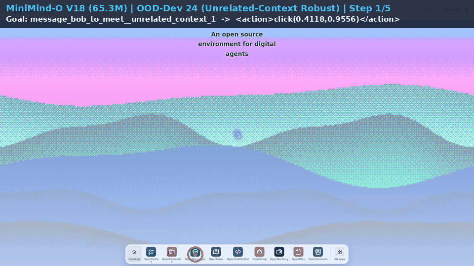
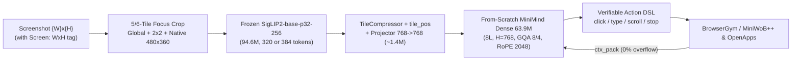

<div align="center">

# MiniMind-O Action

**A 63.9M From-Scratch Vision-Language GUI Agent for Constrained Closed-Loop Control**

[**English**](README.md) · [**简体中文**](README_CN.md)

<p>
  
  
  
  
  
  
</p>

<p>
  <a href="#-live-closed-loop-demos">Demos</a> •
  <a href="#-highlights">Highlights</a> •
  <a href="#-architecture">Architecture</a> •
  <a href="#-benchmarks">Benchmarks</a> •
  <a href="#-quickstart">Quickstart</a> •
  <a href="#-scope--license">Scope &amp; License</a>
</p>

</div>

---

**MiniMind-O Action** explores lightweight multimodal GUI control: a **63.9M-parameter MiniMind Dense backbone pretrained from random initialization** (`3.61B` tokens → RoPE `2048`), fused with a frozen **SigLIP2** vision encoder via a **5/6-Tile Focus Crop** interface (`65.3M` trainable parameters) and a verifiable `<action>…</action>` DSL for **BrowserGym / MiniWoB++** and **OpenApps**.

> **Companion Project:** [**GUI-Transition-Verifier**](https://github.com/ca1tshame/GUI-Transition-Verifier) — explores the complementary **heavy-model** regime (`Qwen3-VL-8B` Policy LoRA, cross-domain Semantic Verifier, and `fastPE` `5.75× / 50.8×` acceleration).

---

## 🎬 Live Closed-Loop Demos

All GIFs below are recorded strictly from **pure student-only rollouts** in real Playwright / BrowserGym / OpenApps sessions ([`assets/demo/`](assets/demo/)). Overlays only log the emitted DSL action and environment reward.

<table>
  <tr>
    <td align="center" width="50%">
      <br/>
      <sub><b>OpenApps 19-Step 3-App Composite</b> — Calendar + Todo + Messages (<code>48.8s</code>, PASS)</sub>
    </td>
    <td align="center" width="50%">
      <br/>
      <sub><b>ONE-SHOT Frozen-20</b> — unseen formal-phrasing Messages (5 steps, PASS)</sub>
    </td>
  </tr>
  <tr>
    <td align="center" width="50%">
      <br/>
      <sub><b>OOD-Dev Distractor Robust</b> — unrelated-context Messages (5 steps, PASS)</sub>
    </td>
    <td align="center" width="50%">
      <br/>
      <sub><b>MiniWoB++ Scroll + Click</b> — <code>scroll_at</code> then <code>click</code> (2 steps, PASS)</sub>
    </td>
  </tr>
</table>

---

## ✨ Highlights

* **🧱 From-Scratch 63.9M Backbone & Zero Overflow**: Pretrained from random initialization (`3.61B` tokens → RoPE `2048`, lowering 2048-window SFT NLL from `2.344 → 1.578`). Token-aware context packing (`ctx_pack`) eliminates long-horizon overflows (**`42.2% → 0%`**).
* **🔍 6-Tile Focus Crop (`384` Visual Tokens)**: Adds a native `480×360` center focus tile alongside global + `2×2` tiles, pushing OpenApps `Input Focus` from `85.7% →` **`100.0%`**, cutting repeated clicks from `24.4% → 0.0%`, and unlocking 19-step cross-app composite tasks.
* **⚖️ Balanced DAgger & Cross-Viewport Conditioning**: Resolves a `16:1` task-family skew via `--balance-dagger` to achieve **`66.7% (8/12)`** on OpenApps Dev (`100%` intent routing) and **`71.88% (23/32)`** on independent MiniWoB++ evaluation; introducing `Screen: {W}x{H}` boosts OOD-Dev (`8.33% → 20.83%`) and unseen `1100×820` Step-0 Dock grounding (`60% → 100%`).
* **🧪 Complete Reproducibility & Verified Footprint**: Backed by **`125` CPU unit tests** and verified A40 `bf16` KV-Cache checkpoint loading (`65.3M` trainable params, **`524.0 ms/step`**, **`343.3 MB`** VRAM).

---

## 🏗️ Architecture



<details>
<summary><b>Parameter Breakdown &amp; Repository Layout (~160M total, 65.3M trainable)</b></summary>

| Component | Parameters | Trainable? |
| --- | ---: | --- |
| MiniMind Dense Backbone (`P1.5/P1.6/SFT`) | `63,912,192` | **From Scratch** |
| Multimodal Interface (`Projector + TileCompressor + tile_pos`) | `~1.39M` | Yes |
| **Total Action Model** | **`65.30M`** | — |
| Frozen SigLIP2 Vision Encoder (`p32-256`) | `94,552,320` | Frozen (external) |

```text
agent/       DSL parser, ctx_pack (Screen: WxH), BrowserGym loop, 5/6-tile Focus vision
models/      MiniMind backbone, FrozenSigLIP2, projector, grounding head
scripts/     pretrain / SFT / GUI SFT / distillation / GRPO / inference / demo
eval/        BrowserGym protocol runner and metrics
configs/     default.yaml, model_config.json, v18_splits.json
tests/       125 CPU unit tests (V1–V18)
docs/        GITHUB_RELEASE_REPORT.md & V18_GENERALIZATION_REPORT.md
```

</details>

---

## 📊 Benchmarks

| Benchmark / Capability | Key Result | Notes |
| --- | --- | --- |
| **2048-Window Language SFT NLL** | **`2.344 → 1.578`** | RoPE `2048` extension after `3.61B`-token pretraining |
| **Long-Horizon Context Overflow** | **`42.2% → 0%`** | Token-aware `ctx_pack` (`ctx=768, vt=384`) |
| **OpenApps `Input Focus` (V16 Focus Crop)** | **`85.7% → 100.0%`** | Unlocks 19-step cross-app `charlie_birthday_surprise` |
| **OpenApps Dev (`12` tasks, V17 Balanced DAgger)** | **`66.7% (8/12)`** | `100%` 3-intent routing; resolves `16:1` task skew |
| **MiniWoB++ Independent `32` (`V17 / V18`)** | **`71.88% (23/32)`** | Preserved alongside multi-viewport conditioning |
| **OpenApps `OOD-Dev` / Unseen `1100×820` Dock** | **`20.83% (5/24)`** / **`100%` Dock** | Unified `Screen: {W}x{H}` sprint (`Frozen-20` `3/20`) |

> Detailed V1–V18 ablation logs—including the V9 grounding head vs. DSL comparison (`35.0%` vs `3.75%`) and V12/V13 sparse-reward GRPO diagnostics—are archived in [`docs/V18_GENERALIZATION_REPORT.md`](docs/V18_GENERALIZATION_REPORT.md) and [`docs/GITHUB_RELEASE_REPORT.md`](docs/GITHUB_RELEASE_REPORT.md).

---

## 🚀 Quickstart

```bash
git clone https://github.com/ca1tshame/minimind-o-action.git
cd minimind-o-action
python -m venv .venv && . .venv/bin/activate
pip install -r requirements.txt

python -m unittest discover -s tests -t .   # Run all 125 CPU unit tests (V1–V18)
```

<details>
<summary><b>Inference, BrowserGym Evaluation, GUI SFT &amp; GRPO Entrypoints</b></summary>

```bash
# Quick inference (6-Tile Focus Crop, 384 visual tokens)
python scripts/inference.py \
  --workspace-root "$MINIMIND_WORKSPACE" \
  --checkpoint checkpoints/v18_iter0/payload/model.safetensors \
  --vision-tokens 384 --context 768 --hist-used 8 --max-new 36 \
  --task click-dialog --seed 20001

# BrowserGym 240-episode evaluation
python eval/miniwob_eval.py \
  --workspace-root "$MINIMIND_WORKSPACE" \
  --checkpoint checkpoints/gui_v14/payload/model.safetensors \
  --protocol historical --out outputs/eval/v14_hist240

# GUI SFT & GRPO research scripts
python scripts/train_gui_sft.py --workspace-root "$MINIMIND_WORKSPACE" --config configs/default.yaml ...
python scripts/train_grpo.py --workspace-root "$MINIMIND_WORKSPACE" --steps 40 --group-size 4 --rollouts-per-step 12
```

</details>

---

## 📦 Scope & License

* **Scope & Roadmap**: Designed as a research exploration of `65.3M` lightweight GUI agents (from-scratch `63.9M` LM + frozen `94.6M` SigLIP2); dense step-level shaping / Dynamic Sampling for sparse-reward GRPO and wider viewport extrapolation remain active next steps (see [`docs/V18_GENERALIZATION_REPORT.md`](docs/V18_GENERALIZATION_REPORT.md)).
* **Licensing & Assets**: Project code is licensed under **Apache-2.0** ([`LICENSE`](LICENSE)). External OpenApps environments follow **CC BY-NC 4.0** (non-commercial research only); checkpoints and raw training frames are not redistributed.
