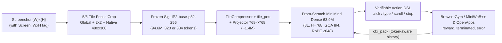

<h1 align="center">MiniMind-O Action</h1>

<p align="center">
  <b>From-Scratch 63.9M Lightweight Vision-Language GUI Agent</b><br/>
  Pretrained from random initialization (<code>3.61B</code> tokens → RoPE <code>2048</code>) and fused with frozen SigLIP2 (<code>5/6-Tile Focus Crop</code>) for closed-loop BrowserGym / MiniWoB++ &amp; OpenApps control.
</p>

<p align="center">
  
  
  
  
  
  
</p>

<p align="center">
  <a href="#1-live-closed-loop-demos">Demos</a> •
  <a href="#2-overview--architecture">Architecture</a> •
  <a href="#3-results-v1v18">Results (V1–V18)</a> •
  <a href="#4-training-pipeline">Training Pipeline</a> •
  <a href="#5-reproducing">Reproducing</a> •
  <a href="#6-honest-limitations">Honest Limits</a>
</p>

MiniMind-O Action is a **from-scratch lightweight vision-language GUI agent**: a **63.9M-parameter MiniMind Dense language backbone** pretrained from random initialization (`3.61B` tokens → RoPE `2048` → language SFT), fused with a frozen **SigLIP2** vision encoder via a multi-scale **5/6-tile Focus Crop** interface (`65.3M` trainable action model) and a single verifiable `<action>…</action>` DSL executed in **BrowserGym / MiniWoB++** and **OpenApps**.

This repository contains the complete **V1 → V18** engineering line: model &amp; KV-cache inference, teacher-distillation &amp; 3-state auditing pipeline, token-aware context packing (`ctx_pack`), V9 grounding ablation, V12/V13 GRPO negative results, V16 6-tile Focus Crop, V17 `--balance-dagger`, and the V18 Unified `Screen: {W}x{H}` multi-viewport sprint ([`docs/V18_GENERALIZATION_REPORT.md`](docs/V18_GENERALIZATION_REPORT.md)).

> **At-a-Glance Highlights &amp; Dual-Checkpoint Summary**
> - **From-Scratch + Zero Overflow**: `2.344 → 1.578` paired 2048-window SFT NLL; `ctx_pack` (`ctx=768, vt=384`) reduces long-horizon context overflows from `42.2% → 0%`.
> - **Focus Tile + Unified Inference**: 6th native `480×360` crop pushes OpenApps `Input Focus` `85.7% → 100.0%` &amp; unlocks 19-step cross-app `charlie_birthday_surprise`; A40 KV-Cache runs at **`524.0 ms/step` / `343.3 MB` alloc VRAM**.
> - **Complementary Checkpoints (Honest Reporting)**: **`v17_b_balanced`** (`--balance-dagger`) achieves **`66.7%` (`8/12`)** on fixed-layout OpenApps Dev (`100%` 3-intent routing); **`v18_iter0`** (`Screen: {W}x{H}`) lifts OOD-Dev **`8.33% → 20.83%`** (`5/24`), ONE-SHOT `Frozen-20` `10.0% → 15.0%` (`3/20`), and unseen `1100×820` Step-0 Dock grounding `60% → 100%`, while preserving MiniWoB `Indep32` at **`23/32 (71.88%)`**. Overall standalone OpenApps generalization and unseen-viewport full episodes remain limited (`0/15`, `0/12`), documented openly in [Section 6](#6-honest-limitations).

> **Scope &amp; Companion Project.** Code, configs and protocols are unit-tested on CPU (`125` tests passing, plus verified real V17 &amp; V18 `vt=384` checkpoint loading on A40); model checkpoints and external BrowserGym / OpenApps installs are **not** redistributed here (see [License &amp; Acknowledgments](#7-license-and-acknowledgments)).<br/>
> *Companion Project: **[GUI-Transition-Verifier](https://github.com/ca1tshame/GUI-Transition-Verifier)** — explores the complementary heavy-model side: `Qwen3-VL-8B` Policy LoRA post-training (`10/19` Dev, `7/12` Heldout), cross-domain Semantic Verifier / PRM adaptation, and `Conv3d → F.linear` operator acceleration (`5.75×` train / `50.8×` infer).*

---

## 1. Live Closed-Loop Demos

All GIFs below were recorded from **pure student-only rollouts** in real Playwright/BrowserGym environments (`assets/demo/`); overlays only annotate the step number, emitted DSL action, and environment reward (no hand-authored coordinates or success flags):

<table>
  <tr>
    <td align="center" width="50%">
      <br/>
      <sub><b>V18 OpenApps 19-step 3-App Composite</b> (<code>charlie_birthday_surprise</code>, 48.8s, PASS)</sub>
    </td>
    <td align="center" width="50%">
      <br/>
      <sub><b>V18 ONE-SHOT Frozen-20</b> (<code>v18_fz_msg_bob_formal</code>, 5 steps, V17 failed)</sub>
    </td>
  </tr>
  <tr>
    <td align="center" width="50%">
      <br/>
      <sub><b>V18 OOD-Dev Distractor Robust</b> (<code>message_bob_to_meet__unrelated_context_1</code>, 5 steps)</sub>
    </td>
    <td align="center" width="50%">
      <br/>
      <sub><b>V14 MiniWoB++ Scroll + Click</b> (<code>scroll-text-2</code>, 2 steps, <code>max_new=48</code> fix)</sub>
    </td>
  </tr>
</table>

| Demo | Steps | Result | What it shows |
|---|---:|---|---|
| `v18_demo1_composite_19step` | 19 | **success, reward 1.0** | V18 OpenApps cross-app Calendar + Todo + Messages (`48.8s`) |
| `v18_demo2_frozen_msg_formal` | 5 | **success, reward 1.0** | V18 **ONE-SHOT Frozen-20** formal-phrasing Messages (`15.9s`, V17 failed) |
| `v18_demo3_ood_unrelated_ctx` | 5 | **success, reward 1.0** | V18 **OOD-Dev** unrelated-context Messages (`15.0s`, V17 failed) |
| `scroll-text-2_seed20008` | 2 | **success, reward 1.0** | V14 MiniWoB `scroll_at(...)` then `click` |
| `login-user_seed20001` | 5 | **success, reward 1.0** | V14 MiniWoB multi-field login form |

<details>
<summary>How Demos Were Recorded &amp; the V14 <code>max_new=24 → 48</code> Scroll Fix (click to expand)</summary>

```bash
python scripts/demo_gui_agent.py --workspace-root "$MINIMIND_WORKSPACE" \
  --checkpoint checkpoints/gui_v14/payload/model.safetensors \
  --task enter-text-2 --seed 20001 \
  --output outputs/demo/enter-text-2_20001.json
python scripts/record_demo_gif.py \
  --trace outputs/demo/enter-text-2_20001.json \
  --frames outputs/demo/enter-text-2_20001_frames \
  --out assets/demo/enter-text-2_20001.gif
```

`demo_gui_agent.py` executes BrowserGym and saves the trace plus one real screenshot per step; `record_demo_gif.py` only overlays the step number, sampled action, reward and environment error on **those** screenshots, and writes `trace_sha256` / `gif_sha256` / `replay_note` next to the GIF.

**Status on V14 checkpoint**: On 2026-11-18 the V14 action model (`65,297,409` parameters) was run against BrowserGym/MiniWoB++ on an A40. With the initial default `max_new=24`, `scroll_at(cx,cy,dx,dy)` truncated at 24 tokens and failed with a parse error; raising the budget to `48` and accepting the 4-argument spelling turned the exact same checkpoint and seed into a 2-step success (see `docs/GITHUB_RELEASE_REPORT.md` §9).

</details>

---

## 2. Overview & Architecture

The project asks a narrow question: *how much GUI competence can a small, from-scratch language model reach when paired with a frozen vision encoder and a strictly verifiable action space?*

- **Language backbone (`63.9M`, trained from scratch)**: MiniMind Dense pretrained from random initialization (`P1.5`), extended to `2048` context via RoPE (`P1.6`), and chat-SFT'd — **not** a downloaded LLM.
- **Vision encoder (`94.6M`, external &amp; frozen)**: SigLIP2-base (`256×256` per tile), bridged via a trainable projector, learned `TileCompressor`, and per-tile `tile_pos`.
- **Verifiable DSL**: every step must parse cleanly into `<action>click(x,y)</action>`, `<action>type("…")</action>`, `<action>type(@S:E|lower)</action>`, `<action>scroll(dx,dy)</action>`, or `<action>stop()</action>`.



| Component | Parameters | Trained here? |
|---|---:|---|
| MiniMind language backbone (P1.5/P1.6/SFT) | 63,912,192 | **from scratch** |
| Projector (`proj.mlp`) | 1,182,720 | yes |
| TileCompressor | 198,657 | yes |
| `tile_pos` | 3,840 | yes |
| **Action model total** | **65,297,409** | — |
| Frozen SigLIP2 vision encoder | 94,552,320 | no (external, frozen) |
| V9 grounding head (ablation only) | 463,363 | yes |

So the full multimodal system is **~160M parameters** (`65.3M` trainable action model + `94.6M` frozen SigLIP2 encoder; `65,298,177` parameters with V16–V18 6-tile `tile_pos`). Vision tokens are configurable: `320` is V11–V14 (`5` tiles × `64`), `384` is V16–V18 (`6` tiles including Focus Crop), and `160/128/64` remain supported legacy layouts via `TileCompressor`.

---

## 3. Results (V1–V18)

*Historical verified runs on BrowserGym / MiniWoB++ and OpenApps; not re-measured on this CPU release machine.*

### 3.1 V15–V18 OpenApps Generalization &amp; Unified `Screen: {W}x{H}` Sprint

Building on V14, the V15–V18 line added a deterministic native `480×360` 6th **Focus Tile** (`vt=384, ctx=768`), balanced DAgger (`--balance-dagger`), floating-Dock occlusion guards (`dock_safe_bottom`), and the **V18 Unified `Screen: {W}x{H}` Protocol** (`agent/ctx_pack.py`, `--layout-per-batch 1`, strictly disjoint `configs/v18_splits.json`). Paired confirmation of V17 (`v17_b_balanced`) vs V18 (`v18_iter0/final_00001200`):

| Evaluation Slice | V17 (`--no-screen-tag`) | V18 (`Screen: {W}x{H}`) | Result / Notes |
|---|---:|---:|---|
| OpenApps `OOD-Dev 24t` (`1920×1080`) | `2/24 (8.33%)` | **`5/24 (20.83%)`** | `+3 / -0` paired net gain (`2.5×`, McNemar `p=0.25`) |
| OpenApps `Interp 1100×820` (`15t`) | `0/15` (Step-0 Dock `60.0%`) | `0/15` (**Step-0 Dock `100.0%`**) | Dock grounding solved (`15/15`); multi-step inner control still `0/15` |
| OpenApps `Extrap 800×900` (`12t`) | `0/12` (Dock `50.0%`) | `0/12` (Dock `33.3%`) | Width `800` lies outside `[860, 1680]` training range |
| **OpenApps ONE-SHOT `Frozen-20`** | `2/20 (10.00%)` | **`3/20 (15.00%)`** | `+1` (`+3/-2` disjoint tasks), Wilson 95% CI `[5.24%, 36.04%]` |
| MiniWoB 4-protocol (`Indep32 / Weak48 / Long64 / Hist240`) | `23/32` / `15/48` / `23/64` / `98/240` | `23/32` / `13/48` / `23/64` / `92/240` | `Indep32` &amp; `Long64` match V17; `-2.50%` trade-off on `Hist240`, **0 overflows** |
| Runtime (A40 GPU KV-Cache `bf16` / isolated VRAM) | `517.6 ms` / `343.3 MB` alloc | **`524.0 ms` / `343.3 MB` alloc** (`372.0 MB` rsv) | Both models verified in `Minimind-action-github`; 8-thread CPU takes `~27.4 s/step` (functional offline, not real-time) |

*Fixed-layout checkpoint comparison*: **`v17_b_balanced`** achieves **`66.7%` (`8/12`)** on fixed-layout OpenApps Dev (`100%` 3-intent routing), whereas **`v18_iter0/final_00001200`** trades fixed-layout specialization for multi-viewport/`OOD-Dev` generalization. Full tables, unified benchmarks, and honest limits live in [`docs/V18_GENERALIZATION_REPORT.md`](docs/V18_GENERALIZATION_REPORT.md).

### 3.2 MiniWoB++ 240-Episode Protocol (V11–V14 Baseline Progression)

Fixed 240-episode protocol (`15 tasks × seeds 20001–20016`, `hist_used=6`): "V14 scaled" uses the 2,783-row balanced distillation set (`2,552` train rows); "V14 control" uses the same trainer on the 2,259-row V11 set.

| Model | Episodes | Success |
|---|---:|---:|
| V11 teacher-distilled SFT | 240 | 64/240 = 26.67% |
| V12 after GRPO (480 on-policy episodes) | 240 | 64/240 = 26.67% |
| V14 control (V11 data, continued SFT) | 240 | 68/240 = 28.33% |
| **V14 scaled (2,552 train rows)** | 240 | **75/240 = 31.25%** |

*Historical Secondary Slices, Pretrain/SFT NLL, V9 Grounding &amp; V12/V13 GRPO Negative Results (summary visible, details collapsed):*

<details>
<summary><b>Language Backbone Pretrain/SFT (`2.344 → 1.578`), MiniWoB Secondary Slices, V9 Grounding (`35.0%` DSL vs `3.75%` Head) &amp; V12/V13 GRPO Negative Result</b></summary>

#### Language Backbone (P1.5 → P1.6 → Full SFT)

| Stage | Metric | Value |
|---|---|---|
| P1.5 pretrain (65,504 updates, 3.61B tokens) | validation NLL / PPL | 1.6539 / 5.2271 |
| P1.6 long-context (40,001 updates, 175.4M tokens) | validation NLL @512 / 1024 / 2048 | 1.7162 / 1.3587 / 1.1970 |
| P1.5 Full SFT | final validation NLL / PPL | 1.23924 / 3.45299 |
| P1.6 Full SFT | final validation NLL / PPL | 1.23841 / 3.45011 |

Evaluated on the same frozen 2048-token real-text windows (`n=53` documents, `108,544` target tokens, no extra EOS), *P1.5 Full SFT vs P1.6 Full SFT* improves **`2.34436 → 1.57849`**, paired document-mean difference **`−0.766`** (95% CI `[−0.858, −0.674]`).

#### Secondary MiniWoB++ Slices (do not compare across protocols)

| Model | Protocol | Success |
|---|---|---:|
| V11/V12 | independent 32 tasks | 15/32 |
| V11/V12 | long 64 (8 tasks × 8 seeds) | 19/64 |
| V11/V12 | unseen weak set 48 | 8/48 |
| V14 scaled | long 64 | 17/64 |
| V12 new seed 32 | independent 32 | 11/32 |
| V13 weak set 48 | unseen weak 48 | 8/48 |

The V14 gain over V11 (+7 episodes on 240) comes with a **long-horizon regression** (`19/64 → 17/64`). Both are reported.

#### V9 Grounding Ablation (new seeds, `n=80`, same checkpoint with two decoding paths)

| Variant | DSL output | Grounding-head output |
|---|---:|---:|
| V8 control (no grounding data) | 10/80 = 12.5% | — |
| V9 DSL-only (text mix) | 14/80 = 17.5% | — |
| **V9 `head2` (one model)** | **28/80 = 35.0%** | **3/80 = 3.75%** |

On the 30-sample slice: V8 `8/30`, V9 DSL `8/30`, `v9_head2` DSL `15/30` (`50.0%`) and head `1/30` (`3.33%`). The head path is a negative result for point-prediction-as-action under this capacity.

#### V12/V13 GRPO Negative Result &amp; Logged Entropy Bug

- **V12**: 480 real on-policy episodes, 40 updates → final 240-episode success identical to V11 (`64/240`).
- **V13**: 40 continuation updates / 480 episodes → `15/32 → 13/32` on fresh 32-task seed.
- **Root cause**: `50%–75%` of rollout groups had zero reward variance, KL stayed `≈0`, and grad norm (`27–48`) saturated at clip `0.3`.
- **Logged entropy bug**: V13 divided per-action-token mean entropy by action length a second time (`0.026–0.068` log was an artifact; single-normalized V12 entropy is `0.60–0.72`). Fixed in `scripts/lib/rl.py` and unit-tested.
- PRM / `GUI-Transition-Verifier` were **not** used in this codebase; nothing here claims they were.

</details>

---

## 4. Training Pipeline

| Stage | Script | What it does |
|---|---|---|
| P1.5 pretrain | `scripts/pretrain_p15.py` | 63.9M LM, 380-token windows, 3.61B target tokens, 65,504 updates |
| P1.6 long context | `scripts/pretrain_p16.py` | Continues P1.5 to 2048 context, 175.4M tokens, 40,001 updates |
| Language SFT | `scripts/full_sft.py` | 768-token chat SFT, 46,667 updates, 321.3M supervised tokens |
| GUI SFT | `scripts/train_gui_sft.py` | V11/V14 base (`5` tiles / `320` tok) &amp; V16–V18 (`6`-tile Focus / `384` tok) with action-weighted CE &amp; 3 replay streams |
| Teacher distillation | `scripts/filter_teacher.py` → `build_distill_dataset.py` | GUI-Owl/V11/Oracle trajectories → verified, deduped, balanced manifest |
| Agentic RL | `scripts/train_grpo.py` | V12/V13 GRPO experiments (negative result, kept for the record) |
| Grounding ablation | `scripts/gui_v9_grounding.py` | V9 auxiliary patch-classification head |

<details>
<summary>V14 GUI SFT Default Hyperparameters (<code>configs/default.yaml</code>, click to expand)</summary>

- Context `512`, `hist_used=6`, `320` vision tokens, `700` steps (`configs/demo.yaml` is a tiny smoke config only).
- Per step: new GUI batch `4` (weight `0.75`) + language replay `1` (`0.15`) + old GUI replay `2` (`0.10`).
- Action-class weights: `click 0.35, type 1.0, scroll 2.0, stop 2.0`.
- Optimizer: AdamW `β=(0.9, 0.95)`, `wd=0.01`, `lr=1e-6` (`lm.model.layers.7.*`, `lm.model.norm.*`) and `2e-5` (`proj.*`, `compressor.*`, `tile_pos.*`), `20`-step warmup → cosine to `0.1×`, clip `1.0`.

</details>

---

## 5. Reproducing

### 5.1 Install &amp; Workspace

```bash
git clone https://github.com/ca1tshame/minimind-o-action.git
cd minimind-o-action
python -m venv .venv && . .venv/bin/activate
pip install -r requirements.txt          # torch, transformers, Pillow, PyYAML
pip install -e ".[eval]"                 # BrowserGym/Playwright, optional
python -m playwright install chromium    # needs network
```

Verified versions: `Python 3.10`, `torch 2.4.1`, `transformers 4.57.6`, `safetensors 0.7.0`, `numpy 1.26.4`, `PyYAML 6.0.3`, `Pillow 9.5.0`. Every path resolves against `--workspace-root` / `MINIMIND_WORKSPACE` (missing weights/files fail fast via `require_paths` / `ActionWeightError`):

```text
$MINIMIND_WORKSPACE/
├── tokenizer/                      # tokenizer.json (vocab 6400, bos/eos/pad 1/2/0)
├── siglip2-base-p32-256/           # config.json + model.safetensors
├── checkpoints/
│   ├── p1_6_sft/                   # language backbone after SFT
│   └── gui_v14/payload/model.safetensors
├── data/
│   ├── gui_v14_scaled_distill/train.jsonl, val.jsonl
│   └── frames/                     # screenshots referenced by the records
└── outputs/
```

### 5.2 CPU Unit Tests (`125` Passing)

```bash
python -m unittest discover -s tests -t .
# or: pytest -q
```

125 tests (`117` V14 core + `8` V18 `Screen: {W}x{H}` / 6-tile Focus384 / tied-LM / CPU SDPA &amp; KV-cache parity tests), no GPU, no network, no browser. Additionally, `scripts/inference.py` was verified on HPC loading real `v17_b_balanced` and `v18_iter0` `vt=384` checkpoints (`65,298,177` parameters) with exact GPU/CPU action parity.

### 5.3 Quick Inference (`V14` &amp; `V16–V18`)

```bash
# V14 5-tile (320 visual tokens, context=512)
python scripts/inference.py \
  --workspace-root "$MINIMIND_WORKSPACE" \
  --checkpoint checkpoints/gui_v14/payload/model.safetensors \
  --task click-dialog --seed 20001 --max-steps 8 \
  --record outputs/demo/click-dialog_20001.json

# V16–V18 6-tile Focus Crop (384 visual tokens, context=768)
python scripts/inference.py \
  --workspace-root "$MINIMIND_WORKSPACE" \
  --checkpoint checkpoints/v18_iter0/payload/model.safetensors \
  --vision-tokens 384 --context 768 --hist-used 8 --max-new 36 \
  --task click-dialog --seed 20001
```

The strict loader validates projector key remapping (`proj.net.* → proj.mlp.*`) and refuses to run if compressor or `tile_pos` tensors are missing (`--dump-load-report` prints parameter mappings).

<details>
<summary>Full BrowserGym Evaluation, GUI SFT, Distillation, GRPO &amp; V9 Grounding Commands (click to expand)</summary>

```bash
# BrowserGym 240-episode evaluation (15 tasks × seeds 20001–20016)
# Set MINIWOB_URL to local MiniWoB++ index.html (and PLAYWRIGHT_BROWSERS_PATH if needed)
python eval/miniwob_eval.py \
  --workspace-root "$MINIMIND_WORKSPACE" \
  --checkpoint checkpoints/gui_v14/payload/model.safetensors \
  --protocol historical --out outputs/eval/v14_hist240

# GUI SFT (gradient accumulation & validation verified)
python scripts/train_gui_sft.py \
  --workspace-root "$MINIMIND_WORKSPACE" \
  --config configs/default.yaml \
  --init-checkpoint checkpoints/v11_teacher_distill/payload/model.safetensors \
  --train-data data/gui_v14_scaled_distill/train.jsonl \
  --val-data data/gui_v14_scaled_distill/val.jsonl \
  --frames-dir data/frames --steps 700 \
  --experiment-dir outputs/experiments/v14

# Teacher filtering, oracle collection & balanced dataset construction
python scripts/filter_teacher.py --workspace-root "$MINIMIND_WORKSPACE" \
  --episodes-dir raw/teacher_episodes --frames-root raw/frames \
  --out data/teacher_filtered.jsonl
python scripts/collect_oracle.py --workspace-root "$MINIMIND_WORKSPACE" \
  --out data/oracle_v14.jsonl --frames-root data/frames
python scripts/build_distill_dataset.py --workspace-root "$MINIMIND_WORKSPACE" \
  --v11-teacher data/v11_teacher.jsonl --v14-oracle data/oracle_v14.jsonl \
  --gui-owl data/gui_owl.jsonl --frames-root data/frames \
  --out data/gui_v14_scaled_distill
python scripts/prepare_gui_sft_data.py --workspace-root "$MINIMIND_WORKSPACE" \
  --records data/gui_v14_scaled_distill/train.jsonl --out data/final

# Agentic RL (V12-style GRPO research entrypoint)
python scripts/train_grpo.py --workspace-root "$MINIMIND_WORKSPACE" \
  --checkpoint checkpoints/gui_v14/payload/model.safetensors \
  --steps 40 --group-size 4 --rollouts-per-step 12

# V9 grounding ablation
python scripts/gui_v9_grounding.py --forward-check
python scripts/gui_v9_ground_collect.py --out data/v9_ground.jsonl
python scripts/gui_v9_mix.py --base data/v9_lang.jsonl \
  --ground data/v9_ground.jsonl --ratio 0.1 --out data/v9_mix
python scripts/gui_v9_ground_eval.py --result-json evals/v9_80.json
```

</details>

---

## 6. Honest Limitations

* **OpenApps standalone generalization remains limited**: V18 achieves `15.0%` (`3/20`) on strictly isolated `v18_frozen_20` and `15/15` Step-0 Dock grounding on `1100×820`, while multi-step inner-page episodes on unseen viewports (`1100×820` `0/15`, extrapolated `800×900` `0/12`) and off-screen scroll targets (`0/4` on Frozen-20) still fail under `65.3M` capacity.
* **MiniWoB++ error budget**: ≈`61.7%` of the 240-episode MiniWoB suite still fails at V18 (`92/240`, vs `75/240` at V14 and `102/240` at V16), showing a mild capacity trade-off (`-2.50%` vs V17) when adding multi-viewport `Screen: {W}x{H}` supervision.
* **Language-mode bias after heavy GUI SFT**: the 10-prompt text probe has `0/10` empty/EOS collapse, yet `5/10` pure-text prompts trigger `<action>click(...)</action>` inertia and small-model arithmetic/factuality stays limited (`"Is 17 prime?" → "No"`).
* **Agentic RL (V12/V13)**: sparse terminal `0/1` GRPO produced no stable gain (`50%–75%` zero-variance groups); the negative result is preserved verbatim.
* **Scope boundaries**: SigLIP2 is external and frozen (the from-scratch claim applies strictly to the `63.9M` language backbone); CPU inference (`~27.4 s/step` on 8-thread Xeon 8358P with KV-cache) is functional offline rather than real-time; speech/audio modality is not integrated.

---

## 7. License and Acknowledgments

* **Project code**: **Apache-2.0** (see [`LICENSE`](LICENSE)).
* **MiniMind / MiniMind-O upstream**: Apache-2.0; modified files are listed in [`NOTICE`](NOTICE).
* **SigLIP2 (`google/siglip2-base-p32-256-ve`)**: external pretrained weights, not redistributed here; check its model card before use.
* **BrowserGym / MiniWoB++ / Gymnasium**: Apache-2.0 (`MiniWoB++`), used as external evaluation environments only.
* **OpenApps desktop environment**: **CC BY-NC 4.0** (external evaluation &amp; training environment only, not vendored here; any V15–V18 checkpoints trained on OpenApps outputs are restricted to non-commercial research use).
* **V9 grounding head**: follows the CenterNet-style focal-loss formulation (MIT); implementation here is original.
* **Withheld assets**: training data, screenshots, teacher (GUI-Owl) weights, and all V1–V18 checkpoints are **not** redistributed (see [`data/README.md`](data/README.md) and [`NOTICE`](NOTICE)).

## Repository Layout

```text
agent/       DSL, token-aware prompt packing (Screen: WxH), BrowserGym loop, 5/6-tile Focus vision
models/      MiniMind backbone, FrozenSigLIP2, projector, grounding head
scripts/     pretrain / SFT / GUI SFT / distillation / GRPO / inference / demo
  lib/       checkpoint transaction, language SFT data, RL primitives
eval/        BrowserGym protocol runner and metrics
configs/     default.yaml (V14 recipe), demo.yaml, model_config.json, v18_splits.json
data/        record schema and pipeline documentation (no raw data)
legacy/      V1 JSON action prototype (not used by the agent)
tests/       125 CPU unittest/pytest tests (V1–V18)
docs/        V14 release report & V18 generalization sprint report
```
