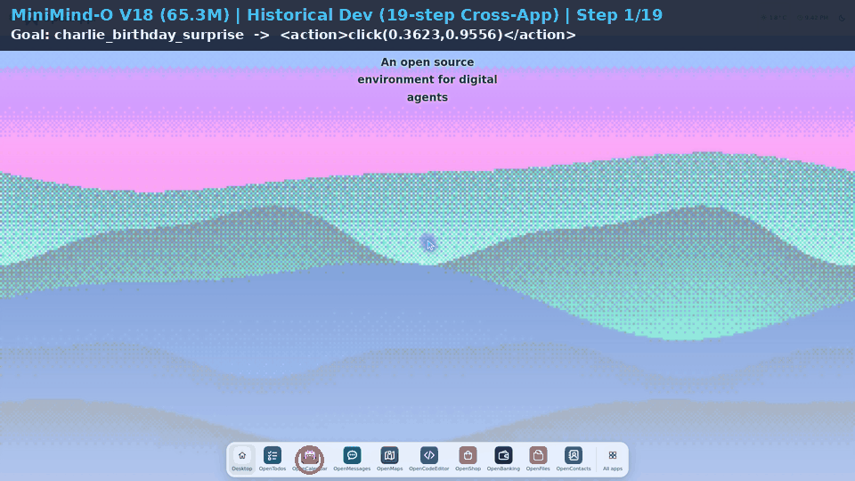
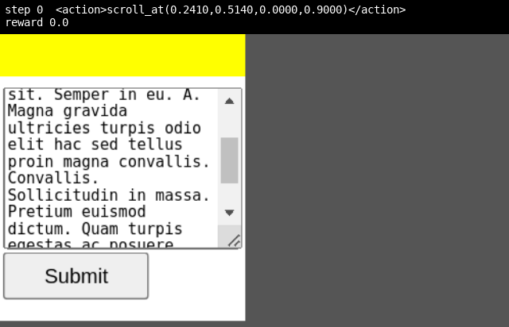
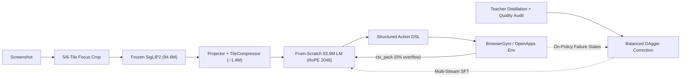

<div align="center">

# MiniMind-O Action

**A 63.9M From-Scratch Language Backbone + Frozen SigLIP2 GUI Agent**

[**English**](README.md) · [**简体中文**](README_CN.md)

<p>
  
  
  
  
  
</p>

<p>
  <a href="#live-demo">Demo</a> •
  <a href="#key-highlights">Highlights</a> •
  <a href="#architecture">Architecture</a> •
  <a href="#selected-results">Results</a> •
  <a href="#quickstart">Quickstart</a> •
  <a href="#documentation">Documentation</a>
</p>

</div>

---

Explores how far a **63.9M Dense language backbone pretrained from random initialization** (`3.61B` tokens → RoPE `2048`) can go on closed-loop BrowserGym & OpenApps control when fused with a **frozen SigLIP2 (`94.6M`)** vision encoder (`~160M` total system, `65.3M` trainable).

> **Companion Project:** [**GUI Agent Post-Training**](https://github.com/ca1tshame/gui-agent-posttraining) *(formerly `GUI-Transition-Verifier`)* — explores the heavy-model regime with `Qwen3-VL-8B` Policy LoRA (`10/19` Dev, `7/12` Heldout), process verification, and `fastPE` acceleration.

---

## Live Demo

All GIFs below are real **pure student-only rollouts** recorded in Playwright / BrowserGym / OpenApps ([`assets/demo/`](assets/demo/)). Overlays only log the emitted DSL action and environment reward.

<table>
  <tr>
    <td align="center" width="50%">
      <br/>
      <sub><b>19-Step 3-App Composite</b> — Calendar + Todo + Messages (<code>48.8s</code>, PASS)</sub>
    </td>
    <td align="center" width="50%">
      <br/>
      <sub><b>Frozen-20 One-Shot Task</b> — unseen formal phrasing (5 steps, PASS)</sub>
    </td>
  </tr>
  <tr>
    <td align="center" width="50%">
      <br/>
      <sub><b>OOD Distractor Robustness</b> — unrelated-context Messages (5 steps, PASS)</sub>
    </td>
    <td align="center" width="50%">
      <br/>
      <sub><b>MiniWoB++ Scroll + Click</b> — <code>scroll_at</code> followed by click (2 steps, PASS)</sub>
    </td>
  </tr>
</table>

---

## Key Highlights

* **From-Scratch `63.9M` Backbone (`3.61B` Tokens)**: Pretrains an 8-layer GQA Dense LM from random initialization and extends context to `2048` via RoPE, lowering 2048-window SFT NLL from `2.344 →` **`1.578`**.
* **6-Tile Local Focus Fusion**: Pairs a frozen `SigLIP2-base-p32-256` (`94.6M`, external weights) with global + `2×2` + native `480×360` focus cropping, lifting controlled OpenApps `Input Focus` from `85.7% →` **`100.0%`**.
* **Token-Aware Context Compression (`ctx_pack`)**: Packs multi-step history dynamically within token budgets (`ctx=768, vt=384`), eliminating long-horizon overflows (**`42.2% → 0%`**).
* **Teacher Distillation & Balanced DAgger**: Filters teacher traces (`GUI-Owl` / oracle) and fixes a `16:1` task-family sampling skew via `--balance-dagger`, reaching **`66.7% (8/12)`** on fixed-layout OpenApps Dev and **`71.88% (23/32)`** on independent MiniWoB++.

---

## Architecture



---

## Selected Results

| Benchmark / Metric | Model Version &amp; Scope | Key Result |
| --- | --- | --- |
| **2048-Window Language SFT NLL** | `P1.5 → P1.6 Full SFT` (`n=53` docs) | **`2.344 → 1.578`** |
| **Long-Horizon Context Overflow** | `V16–V18` `ctx_pack` (`ctx=768, vt=384`) | **`42.2% → 0%`** |
| **OpenApps `Input Focus` Rate** | `V16` paired ablation (`vt=320` vs `384`) | **`85.7% → 100.0%`** |
| **OpenApps Fixed-Layout Dev (`12` tasks)** | `V17` (`--balance-dagger`, `1920×1080`) | **`8/12` (`66.7%`)** |
| **MiniWoB++ Independent `32` Split** | `V17` &amp; `V18` (`Screen: {W}x{H}`) | **`23/32` (`71.88%`)** |

> *Checkpoints `V17` (fixed-layout specialist) and `V18` (multi-viewport sprint) represent different evaluation configurations. Non-significant `OOD-Dev` gains (`2/24 → 5/24`, `p=0.25`), low `Frozen-20` (`3/20`) / unseen-viewport multi-step ceilings (`0/15`, `0/12`), and V12/V13 sparse-reward GRPO zero-variance findings are documented in [`docs/V18_GENERALIZATION_REPORT.md`](docs/V18_GENERALIZATION_REPORT.md).*

---

## Quickstart

All **125 CPU unit tests** run directly with no GPU, browser, or external checkpoints:

```bash
git clone https://github.com/ca1tshame/minimind-o-action.git
cd minimind-o-action
python -m venv .venv && . .venv/bin/activate
pip install -r requirements.txt

python -m unittest discover -s tests -t .
```

> Inference demos, BrowserGym 240-episode evaluation, GUI SFT, and GRPO training require local `SigLIP2` weights, trained checkpoints under `$MINIMIND_WORKSPACE`, and Playwright/BrowserGym; full commands and hardware footprints (`A40 524 ms/step, 343 MB VRAM`) are in [`docs/V18_GENERALIZATION_REPORT.md`](docs/V18_GENERALIZATION_REPORT.md) and [`docs/GITHUB_RELEASE_REPORT.md`](docs/GITHUB_RELEASE_REPORT.md).

---

## Documentation

- [`docs/V18_GENERALIZATION_REPORT.md`](docs/V18_GENERALIZATION_REPORT.md): V15–V18 Focus Crop, Balanced DAgger, `Screen: {W}x{H}` sprint, OOD/Frozen-20/viewport limits, and A40/CPU benchmarks.
- [`docs/GITHUB_RELEASE_REPORT.md`](docs/GITHUB_RELEASE_REPORT.md): P1.5/P1.6 pretraining metrics, MiniWoB 240-episode progression, V9 grounding ablation, V12/V13 GRPO negative results, and text-inertia probe.
- [`assets/demo/README.md`](assets/demo/README.md): Trace SHA-256 verification metadata for all recorded rollout GIFs.

**License:** Apache-2.0 ([`LICENSE`](LICENSE)). `SigLIP2` and `OpenApps` (CC BY-NC 4.0) remain governed by their upstream licenses; checkpoints and raw frames are not redistributed.
