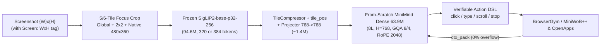

<div align="center">

# MiniMind-O Action

**A 63.9M From-Scratch Vision-Language GUI Agent for Constrained Closed-Loop Control**

[**English**](README.md) · [**简体中文**](README_CN.md)

<p>
  
  
  
  
  
  
</p>

<p>
  <a href="#-live-closed-loop-demos">Demos</a> •
  <a href="#-highlights">Highlights</a> •
  <a href="#-architecture">Architecture</a> •
  <a href="#-benchmarks">Benchmarks</a> •
  <a href="#-quickstart">Quickstart</a> •
  <a href="#-honest-limits--negative-results">Honest Limits</a>
</p>

</div>

---

**MiniMind-O Action** asks a focused question: *how far can a **63.9M-parameter language backbone pretrained from random initialization** (`3.61B` tokens → RoPE `2048`) go on closed-loop desktop & browser GUI control when paired with a frozen **SigLIP2** encoder and a verifiable `<action>…</action>` DSL?*

> **Companion Project:** [**GUI-Transition-Verifier**](https://github.com/ca1tshame/GUI-Transition-Verifier) — explores the complementary **heavy-model** regime: `Qwen3-VL-8B` Policy LoRA (`10/19` Dev, `7/12` Heldout), cross-domain Semantic Verifier, and `5.75× / 50.8×` `fastPE` acceleration.

---

## 🎬 Live Closed-Loop Demos

All GIFs below are recorded strictly from **pure student-only rollouts** in real Playwright / BrowserGym / OpenApps sessions (`assets/demo/`). Overlays only log the student's emitted DSL action and environment reward.

<table>
  <tr>
    <td align="center" width="50%">
      <br/>
      <sub><b>OpenApps 19-Step 3-App Composite</b> — Calendar + Todo + Messages (<code>48.8s</code>, PASS)</sub>
    </td>
    <td align="center" width="50%">
      <br/>
      <sub><b>ONE-SHOT Frozen-20</b> — unseen formal-phrasing Messages (5 steps, V17 failed)</sub>
    </td>
  </tr>
  <tr>
    <td align="center" width="50%">
      <br/>
      <sub><b>OOD-Dev Distractor Robust</b> — unrelated-context Messages (5 steps, V17 failed)</sub>
    </td>
    <td align="center" width="50%">
      <br/>
      <sub><b>MiniWoB++ Scroll + Click</b> — <code>scroll_at</code> then <code>click</code> (2 steps)</sub>
    </td>
  </tr>
</table>

---

## ✨ Highlights

* **🧱 From-Scratch 63.9M Backbone & Zero Overflow**: Pretrained from random initialization (`3.61B` tokens → RoPE `2048`, reducing 2048-window SFT NLL from `2.344 → 1.578`). Token-aware `ctx_pack` eliminates long-horizon context overflows (**`42.2% → 0%`**).
* **🔍 6-Tile Focus Crop (`384` Visual Tokens)**: Adds a native `480×360` center focus tile alongside global + `2×2` tiles, pushing OpenApps form `Input Focus` from `85.7% →` **`100.0%`**, cutting repeated clicks from `24.4% → 0.0%`, and unlocking 19-step cross-app `charlie_birthday_surprise`.
* **⚖️ Balanced DAgger & Cross-Viewport Sprint**: Fixes a `16:1` task-family skew via `--balance-dagger`, lifting fixed-layout OpenApps Dev to **`66.7% (8/12)`**. Adding `Screen: {W}x{H}` multi-viewport conditioning lifts `OOD-Dev` (`8.33% → 20.83%`) and unseen `1100×820` Step-0 Dock grounding (`60% → 100%`) while preserving MiniWoB `Indep32` at **`23/32 (71.88%)`**.
* **🧪 125 CPU Tests & Verified Footprint**: `125` passing CPU unit tests + verified A40 `bf16` KV-Cache checkpoint loading (`65.3M` trainable params, **`524.0 ms/step`**, **`343.3 MB`** allocated VRAM).

---

## 🏗️ Architecture



<details>
<summary><b>Parameter Breakdown &amp; Repository Layout (~160M total, 65.3M trainable)</b></summary>

| Component | Parameters | Trainable? |
| --- | ---: | --- |
| MiniMind Dense Backbone (`P1.5/P1.6/SFT`) | `63,912,192` | **From Scratch** |
| Multimodal Interface (`Projector + TileCompressor + tile_pos`) | `~1.39M` | Yes |
| **Total Action Model** | **`65.30M`** | — |
| Frozen SigLIP2 Vision Encoder (`p32-256`) | `94,552,320` | Frozen (external) |

```text
agent/       DSL parser, ctx_pack (Screen: WxH), BrowserGym loop, 5/6-tile Focus vision
models/      MiniMind backbone, FrozenSigLIP2, projector, V9 grounding head
scripts/     pretrain / SFT / GUI SFT / distillation / GRPO / inference / demo
eval/        BrowserGym protocol runner and metrics
configs/     default.yaml, model_config.json, v18_splits.json
tests/       125 CPU unit tests (V1–V18)
docs/        GITHUB_RELEASE_REPORT.md & V18_GENERALIZATION_REPORT.md
```

</details>

---

## 📊 Benchmarks

### 1. V17 vs. V18 Paired OpenApps &amp; MiniWoB++ Evaluation

| Evaluation Split | V17 (`--balance-dagger`) | V18 (`Screen: {W}x{H}`) | Notes &amp; Honest Scope |
| --- | ---: | ---: | --- |
| **Fixed-Layout OpenApps Dev (`12t`)** | **`8/12 (66.7%)`** | `5/12 (41.7%)` | V17 specializes better on fixed `1920×1080` (`100%` intent routing) |
| **OpenApps `OOD-Dev` (`24t`, `1920×1080`)** | `2/24 (8.33%)` | **`5/24 (20.83%)`** | `+3 / -0` paired wins (`McNemar p=0.25`, small-N CI) |
| **OpenApps `ONE-SHOT Frozen-20`** | `2/20 (10.00%)` | **`3/20 (15.00%)`** | Zero tuning before eval (`Wilson CI [5.24%, 36.04%]`) |
| **Unseen `1100×820` (`15t`) Step-0 Dock** | `9/15 (60.0%)` | **`15/15 (100.0%)`** | Dock grounding solved; multi-step inner control still `0/15` |
| **MiniWoB `Indep32` / `Long64`** | **`23/32` (`71.88%`)** / `23/64` | **`23/32` (`71.88%`)** / `23/64` | Full preservation with `0` context overflows |
| **MiniWoB `Hist240` (`15 × 16 seeds`)** | **`98/240 (40.83%)`** | `92/240 (38.33%)` | `-2.50%` capacity trade-off for multi-viewport supervision |

<details>
<summary><b>Detailed History: Pretrain/SFT NLL, V11–V14 Progression, V9 Grounding &amp; V12/V13 GRPO</b></summary>

* **Language Backbone (`P1.5 → P1.6 → SFT`)**: Pretrained on `3.61B` tokens (`65,504` steps), extended to `2048` context (`175.4M` tokens). On frozen 2048-token windows (`n=53` docs), `P1.6 Full SFT` improves NLL from **`2.344 → 1.578`** (`-0.766`, 95% CI `[−0.858, −0.674]`).
* **V11–V14 MiniWoB `Hist240` Progression**: `V11 (26.67%, 64/240)` → `V12 GRPO (26.67%, 64/240)` → `V14 control (28.33%, 68/240)` → `V14 scaled (31.25%, 75/240)` (noting a long-horizon regression `19/64 → 17/64` on `Long64` before V16 Focus Crop).
* **V9 Grounding Head Ablation (`n=80`)**: Unified DSL output reached **`28/80 (35.0%)`** vs. auxiliary CenterNet-style grounding head **`3/80 (3.75%)`** — showing point-prediction heads underperform unified text-DSL action decoding at `65M` scale.
* **V12/V13 GRPO Negative Result**: Sparse `0/1` terminal rewards caused `50%–75%` of rollout groups to have zero reward variance (`KL ≈ 0`, grad norm saturated at clip `0.3`). Also fixed a double-length entropy normalization logging bug in `scripts/lib/rl.py`.
* Full tables live in [`docs/V18_GENERALIZATION_REPORT.md`](docs/V18_GENERALIZATION_REPORT.md) and [`docs/GITHUB_RELEASE_REPORT.md`](docs/GITHUB_RELEASE_REPORT.md).

</details>

---

## 🚀 Quickstart

### 1. Run All 125 CPU Unit Tests (No GPU / Browser Required)

```bash
git clone https://github.com/ca1tshame/minimind-o-action.git
cd minimind-o-action
python -m venv .venv && . .venv/bin/activate
pip install -r requirements.txt

python -m unittest discover -s tests -t .   # 125 passing CPU tests (V1–V18)
```

<details>
<summary><b>2. Inference, BrowserGym Evaluation, GUI SFT &amp; GRPO Commands</b></summary>

```bash
# Quick inference (V16–V18 6-Tile Focus Crop, 384 visual tokens)
python scripts/inference.py \
  --workspace-root "$MINIMIND_WORKSPACE" \
  --checkpoint checkpoints/v18_iter0/payload/model.safetensors \
  --vision-tokens 384 --context 768 --hist-used 8 --max-new 36 \
  --task click-dialog --seed 20001

# BrowserGym 240-episode evaluation
python eval/miniwob_eval.py \
  --workspace-root "$MINIMIND_WORKSPACE" \
  --checkpoint checkpoints/gui_v14/payload/model.safetensors \
  --protocol historical --out outputs/eval/v14_hist240

# GUI SFT & V12-style GRPO research entrypoint
python scripts/train_gui_sft.py --workspace-root "$MINIMIND_WORKSPACE" --config configs/default.yaml ...
python scripts/train_grpo.py --workspace-root "$MINIMIND_WORKSPACE" --steps 40 --group-size 4 --rollouts-per-step 12
```

</details>

---

## 🔍 Honest Limits & Negative Results

1. **Standalone Generalization Ceiling at `65.3M`**: While V18 reaches `15.0% (3/20)` on `Frozen-20` and `15/15` Step-0 Dock grounding on `1100×820`, multi-step inner-page control on unseen viewports (`1100×820` `0/15`, extrapolated `800×900` `0/12`) and off-screen scroll targets (`0/4` on Frozen-20) remain unsolved at this parameter budget.
2. **Sparse-Reward GRPO Collapse (V12/V13)**: Pure terminal `0/1` GRPO yielded `50%–75%` zero-variance groups (`64/240` flat on V12; `15/32 → 13/32` regression on V13), motivating future dense step-level shaping / Dynamic Sampling.
3. **Text Inertia After Heavy GUI SFT**: On a 10-prompt text probe, `0/10` collapsed to empty/EOS, but `5/10` pure-text prompts triggered `<action>click(...)</action>` inertia and small-LM factuality remains limited (`"Is 17 prime?" → "No"`).
4. **Hardware & Scope Boundaries**: SigLIP2 (`94.6M`) is external and frozen (the from-scratch claim applies strictly to the `63.9M` LM). CPU KV-cache inference (`~27.4s/step` on 8-thread Xeon 8358P) is functional offline, not real-time.
5. **Licensing**: Project code is **Apache-2.0** ([`LICENSE`](LICENSE)); OpenApps is **CC BY-NC 4.0** (non-commercial research only); checkpoints and screenshots are withheld.
