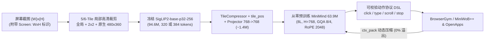

<div align="center">

# MiniMind-O Action

**面向受限场景的 63.9M 从零预训练多模态 GUI Agent**

[**English**](README.md) · [**简体中文**](README_CN.md)

<p>
  
  
  
  
  
  
</p>

<p>
  <a href="#-真实闭环演示">真实演示</a> •
  <a href="#-核心亮点">核心亮点</a> •
  <a href="#-模型架构">模型架构</a> •
  <a href="#-核心实验结果">实验结果</a> •
  <a href="#-快速开始">快速开始</a> •
  <a href="#-范围说明与开源协议">范围与协议</a>
</p>

</div>

---

**MiniMind-O Action** 聚焦端侧受限场景下的轻量级多模态 GUI 控制：从随机初始化完成 **63.9M MiniMind Dense 语言主干**预训练（`3.61B` tokens → RoPE `2048`），接入冻结 **SigLIP2** 视觉编码器与 **5/6-Tile 局部高清裁剪**（可训练参数 `65.3M`），通过严格可校验的 `<action>…</action>` 动作协议在 **BrowserGym / MiniWoB++** 与 **OpenApps** 中实现真实闭环交互。

> **姊妹仓库：** [**GUI-Transition-Verifier**](https://github.com/ca1tshame/GUI-Transition-Verifier) —— 探索互补的**大模型**方向：`Qwen3-VL-8B` 策略 LoRA 后训练（Dev `10/19`、Heldout `7/12`）、跨环境过程验证与 `fastPE` `5.75× / 50.8×` 算子加速。

---

## 🎬 真实闭环演示

以下 GIF 均由 **纯学生模型在真实 Playwright / BrowserGym / OpenApps 环境中实时运行录制**（[`assets/demo/`](assets/demo/)），画面叠加层仅忠实记录模型输出的动作指令与环境返回奖励。

<table>
  <tr>
    <td align="center" width="50%">
      <br/>
      <sub><b>OpenApps 19 步跨三应用复合任务</b> — 日历 + 待办 + 消息自主联动（<code>48.8s</code>，通过）</sub>
    </td>
    <td align="center" width="50%">
      <br/>
      <sub><b>一次性冻结测试集（Frozen-20）</b> — 未见正式句式消息发送（5 步通过）</sub>
    </td>
  </tr>
  <tr>
    <td align="center" width="50%">
      <br/>
      <sub><b>OOD 抗干扰鲁棒性</b> — 含无关上下文干扰的消息任务（5 步通过）</sub>
    </td>
    <td align="center" width="50%">
      <br/>
      <sub><b>MiniWoB++ 滚动 + 点击</b> — <code>scroll_at</code> 后精准点击（2 步通过）</sub>
    </td>
  </tr>
</table>

---

## ✨ 核心亮点

* **🧱 63.9M 从零预训练与零上下文溢出**：随机初始化完成 `3.61B` tokens 预训练并经 RoPE 扩窗至 `2048`（2048 窗口 SFT NLL 从 `2.344 → 1.578`）；设计基于 Token 预算的动态历史压缩机制（`ctx_pack`），将长程交互溢出率从 **`42.2%` 降至 `0%`**。
* **🔍 6-Tile 局部高清融合（`384` 视觉 Token）**：在全局缩略图与 `2×2` 分块外新增原生 `480×360` 中心聚焦裁剪，将 OpenApps 表单输入框聚焦率从 `85.7%` 提升至 **`100.0%`**，重复点击率降至 `0.0%`，并解锁 19 步跨三应用复合任务。
* **⚖️ 均衡 DAgger 与跨分辨率探索**：通过 `--balance-dagger` 纠正 `16:1` 任务类别采样失衡，在 OpenApps Dev 取得 **`66.7%（8/12）`** 成功率（三意图路由 `100%`），在 MiniWoB++ 独立测试集保持 **`71.88%（23/32）`**；引入 `Screen: {W}x{H}` 条件将 `OOD-Dev` 从 `8.33%` 提升至 **`20.83%`**、未见 `1100×820` 首步 Dock 定位达 **`100%`**。
* **🧪 完备单测与轻量化实测开销**：覆盖全链路 **`125` 项 CPU 单元测试**，并在 A40 单卡隔离进程完成 `bf16` KV-Cache 实测（`65.3M` 可训练参数，**`524.0 ms/步`**、**`343.3 MB`** 显存）。

---

## 🏗️ 模型架构



<details>
<summary><b>参数构成与代码目录（总计 ~160M，可训练 65.3M）</b></summary>

| 组件 | 参数量 | 是否本仓库训练 |
| --- | ---: | --- |
| MiniMind Dense 语言主干 (`P1.5/P1.6/SFT`) | `63,912,192` | **从零训练** |
| 跨模态接口 (`Projector + TileCompressor + tile_pos`) | `~1.39M` | 是 |
| **动作模型可训练总参数** | **`65.30M`** | — |
| 冻结 SigLIP2 视觉编码器 (`p32-256`) | `94,552,320` | 否（外部冻结权重） |

```text
agent/       DSL 解析、ctx_pack (Screen: WxH)、BrowserGym 闭环、5/6-Tile 聚焦视觉
models/      MiniMind 主干、FrozenSigLIP2、Projector、定位头
scripts/     预训练 / SFT / GUI SFT / 蒸馏 / GRPO / 推理 / 演示录制
eval/        BrowserGym 评测协议与指标计算
configs/     default.yaml、model_config.json、v18_splits.json
tests/       125 项 CPU 单元测试 (V1–V18)
docs/        GITHUB_RELEASE_REPORT.md 与 V18_GENERALIZATION_REPORT.md
```

</details>

---

## 📊 核心实验结果

| 评测项 | 核心结果 | 说明 |
| --- | --- | --- |
| **2048 窗口语言 SFT NLL** | **`2.344 → 1.578`** | `3.61B` tokens 预训练后接续 RoPE `2048` 长上下文扩展 |
| **长程上下文溢出率** | **`42.2% → 0%`** | `ctx_pack` 动态历史压缩（`ctx=768, vt=384`） |
| **OpenApps 输入框聚焦率（Focus Crop）** | **`85.7% → 100.0%`** | 解锁 19 步跨三应用自主执行 |
| **OpenApps Dev（12 题，均衡 DAgger）** | **`66.7%（8/12）`** | 三意图路由 `100%`，纠正 `16:1` 任务采样偏斜 |
| **MiniWoB++ 独立测试（32 题）** | **`71.88%（23/32）`** | 跨版本稳定保持基础操作与长程规划能力 |
| **OpenApps `OOD-Dev` / 未见 `1100×820` Dock** | **`20.83%（5/24）`** / **`100%`** | `Screen: {W}x{H}` 多分辨率条件（`Frozen-20` `3/20`） |

> 完整 V1–V18 演进消融——包括 V9 辅助定位头 vs. 文本 DSL 对比（`35.0%` vs `3.75%`）以及 V12/V13 稀疏奖励 GRPO 实验诊断——均归档于 [`docs/V18_GENERALIZATION_REPORT.md`](docs/V18_GENERALIZATION_REPORT.md) 与 [`docs/GITHUB_RELEASE_REPORT.md`](docs/GITHUB_RELEASE_REPORT.md)。

---

## 🚀 快速开始

```bash
git clone https://github.com/ca1tshame/minimind-o-action.git
cd minimind-o-action
python -m venv .venv && . .venv/bin/activate
pip install -r requirements.txt

python -m unittest discover -s tests -t .   # 运行 V1–V18 共 125 项 CPU 单元测试
```

<details>
<summary><b>推理演示、BrowserGym 评测、GUI SFT 与 GRPO 实验命令</b></summary>

```bash
# 单步闭环推理（6-Tile 聚焦模式，384 视觉 token）
python scripts/inference.py \
  --workspace-root "$MINIMIND_WORKSPACE" \
  --checkpoint checkpoints/v18_iter0/payload/model.safetensors \
  --vision-tokens 384 --context 768 --hist-used 8 --max-new 36 \
  --task click-dialog --seed 20001

# BrowserGym 240 局标准化评测
python eval/miniwob_eval.py \
  --workspace-root "$MINIMIND_WORKSPACE" \
  --checkpoint checkpoints/gui_v14/payload/model.safetensors \
  --protocol historical --out outputs/eval/v14_hist240

# GUI SFT 与 GRPO 研究训练入口
python scripts/train_gui_sft.py --workspace-root "$MINIMIND_WORKSPACE" --config configs/default.yaml ...
python scripts/train_grpo.py --workspace-root "$MINIMIND_WORKSPACE" --steps 40 --group-size 4 --rollouts-per-step 12
```

</details>

---

## 📦 范围说明与开源协议

* **研究范围与后续规划**：本仓库聚焦 `65.3M` 轻量级 GUI Agent 的能力边界探索（`63.9M` 从零预训练语言主干 + 冻结 `94.6M` SigLIP2）；后续将重点围绕稀疏奖励下的过程塑形 / Dynamic Sampling GRPO 优化与更宽分辨率外推继续推进（详见 [`docs/V18_GENERALIZATION_REPORT.md`](docs/V18_GENERALIZATION_REPORT.md)）。
* **协议与资产说明**：代码采用 **Apache-2.0** 协议（[`LICENSE`](LICENSE)）；OpenApps 环境遵循 **CC BY-NC 4.0**（仅限非商用研究），模型权重与原始训练截图不随仓分发。
