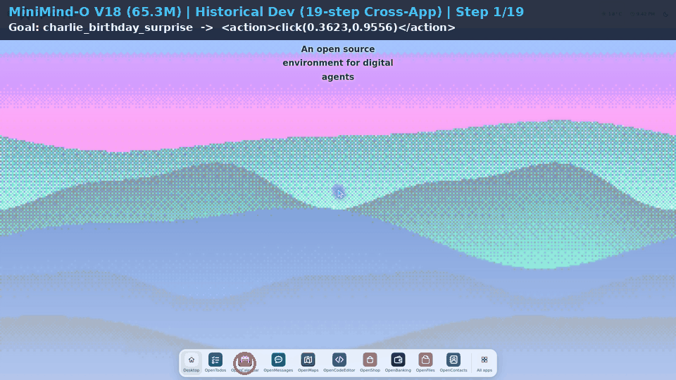
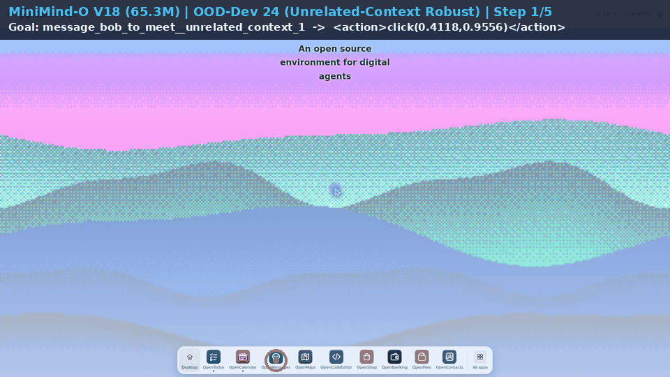
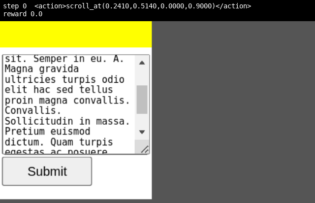
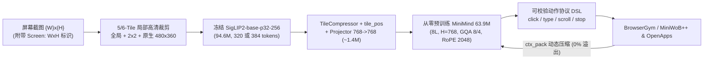

<div align="center">

# MiniMind-O Action

**面向受限场景的 63.9M 从零预训练多模态 GUI Agent**

[**English**](README.md) · [**简体中文**](README_CN.md)

<p>
  
  
  
  
  
  
</p>

<p>
  <a href="#-真实闭环演示">真实演示</a> •
  <a href="#-核心亮点">核心亮点</a> •
  <a href="#-模型架构">模型架构</a> •
  <a href="#-核心实验结果">实验结果</a> •
  <a href="#-快速开始">快速开始</a> •
  <a href="#-诚实边界与负实验复盘">诚实复盘</a>
</p>

</div>

---

**MiniMind-O Action** 探索一个明确的极简问题：*一个**从随机初始化从零预训练的 63.9M 纯语言主干**（`3.61B` tokens → RoPE `2048`），在接入冻结 **SigLIP2** 视觉编码器与严格可校验的 `<action>…</action>` 动作协议后，在真实 BrowserGym 与 OpenApps 闭环 GUI 控制中究竟能走多远？*

> **姊妹仓库：** [**GUI-Transition-Verifier**](https://github.com/ca1tshame/GUI-Transition-Verifier) —— 探索互补的**大模型**方向：`Qwen3-VL-8B` 策略 LoRA 后训练（Dev `10/19`、Heldout `7/12`）、跨环境过程验证与 `5.75× / 50.8×` `fastPE` 算子加速。

---

## 🎬 真实闭环演示

以下 GIF 均由 **纯学生模型在真实 Playwright / BrowserGym / OpenApps 环境中实时运行录制**（[`assets/demo/`](assets/demo/)），画面叠加层仅忠实记录模型输出的动作字符串与环境返回奖励，无任何手工预设坐标。

<table>
  <tr>
    <td align="center" width="50%">
      <br/>
      <sub><b>OpenApps 19 步跨三应用复合任务</b> — 日历 + 待办 + 消息自主联动（<code>48.8s</code>，通过）</sub>
    </td>
    <td align="center" width="50%">
      <br/>
      <sub><b>一次性冻结测试集（Frozen-20）</b> — 未见正式句式消息发送（5 步通过，V17 失败）</sub>
    </td>
  </tr>
  <tr>
    <td align="center" width="50%">
      <br/>
      <sub><b>OOD 抗干扰鲁棒性</b> — 含无关上下文干扰的消息任务（5 步通过，V17 失败）</sub>
    </td>
    <td align="center" width="50%">
      <br/>
      <sub><b>MiniWoB++ 滚动 + 点击</b> — <code>scroll_at</code> 后精准点击（2 步通过）</sub>
    </td>
  </tr>
</table>

---

## ✨ 核心亮点

* **🧱 63.9M 从零预训练与零上下文溢出**：随机初始化完成 `3.61B` tokens 预训练并经 RoPE 扩窗至 `2048`（2048 窗口验证 NLL 从 `2.344 → 1.578`）；设计基于 Token 预算的动态历史压缩机制（`ctx_pack`），将长程上下文溢出从 **`42.2%` 降至 `0%`**。
* **🔍 6-Tile 局部高清融合（`384` 视觉 Token）**：在全局缩略图与 `2×2` 分块外新增原生 `480×360` 中心聚焦裁剪，在 OpenApps 配对消融中将表单输入框聚焦率从 `85.7%` 提升至 **`100.0%`**，重复点击率从 `24.4%` 降至 `0.0%`，解锁 19 步跨应用复合任务。
* **⚖️ 均衡 DAgger 与跨分辨率探索**：通过 `--balance-dagger` 纠正 `16:1` 任务类别采样失衡，将固定布局 OpenApps Dev 成功率推至 **`66.7%（8/12）`**；进一步引入 `Screen: {W}x{H}` 视口条件将 `OOD-Dev` 从 `8.33%` 提升至 **`20.83%`**、未见 `1100×820` 分辨率首步 Dock 定位达 **`100%`**，同时保持 MiniWoB `Indep32` 在 **`23/32（71.88%）`**。
* **🧪 125 项 CPU 单测与实测资源开销**：覆盖全链路 `125` 项 CPU 单元测试，并在 A40 隔离进程实测 `bf16` KV-Cache 推理（`65.3M` 可训练参数，**`524.0 ms/步`**、**`343.3 MB`** 分配显存）。

---

## 🏗️ 模型架构



<details>
<summary><b>参数构成与代码目录（总计 ~160M，可训练 65.3M）</b></summary>

| 组件 | 参数量 | 是否本仓库训练 |
| --- | ---: | --- |
| MiniMind Dense 语言主干 (`P1.5/P1.6/SFT`) | `63,912,192` | **从零训练** |
| 跨模态接口 (`Projector + TileCompressor + tile_pos`) | `~1.39M` | 是 |
| **动作模型可训练总参数** | **`65.30M`** | — |
| 冻结 SigLIP2 视觉编码器 (`p32-256`) | `94,552,320` | 否（外部冻结权重） |

```text
agent/       DSL 解析、ctx_pack (Screen: WxH)、BrowserGym 闭环、5/6-Tile 聚焦视觉
models/      MiniMind 主干、FrozenSigLIP2、Projector、V9 定位头
scripts/     预训练 / SFT / GUI SFT / 蒸馏 / GRPO / 推理 / 演示录制
eval/        BrowserGym 评测协议与指标计算
configs/     default.yaml、model_config.json、v18_splits.json
tests/       125 项 CPU 单元测试 (V1–V18)
docs/        GITHUB_RELEASE_REPORT.md 与 V18_GENERALIZATION_REPORT.md
```

</details>

---

## 📊 核心实验结果

### 1. V17 vs. V18 OpenApps 与 MiniWoB++ 配对评测

| 评测集 | V17 (`--balance-dagger`) | V18 (`Screen: {W}x{H}`) | 结果解读与边界 |
| --- | ---: | ---: | --- |
| **固定布局 OpenApps Dev（12 题）** | **`8/12 (66.7%)`** | `5/12 (41.7%)` | V17 在固定 `1920×1080` 上专精更好（3 意图路由 `100%`） |
| **OpenApps `OOD-Dev`（24 题，`1920×1080`）** | `2/24 (8.33%)` | **`5/24 (20.83%)`** | 配对净胜 `+3 / -0`（`McNemar p=0.25`，受小样本限制） |
| **OpenApps `Frozen-20`（一次性冻结）** | `2/20 (10.00%)` | **`3/20 (15.00%)`** | 选型全程零接触（`Wilson CI [5.24%, 36.04%]`） |
| **未见 `1100×820`（15 题）首步 Dock 定位** | `9/15 (60.0%)` | **`15/15 (100.0%)`** | 解决 Dock 定位偏移，但内页多步整局仍为 `0/15` |
| **MiniWoB `Indep32` / `Long64`** | **`23/32` (`71.88%`)** / `23/64` | **`23/32` (`71.88%`)** / `23/64` | 完整保留基础与长程能力，且上下文 **`0` 溢出** |
| **MiniWoB `Hist240`（15 任务 × 16 种子）** | **`98/240 (40.83%)`** | `92/240 (38.33%)` | 为多分辨率监督让渡 `-2.50%` 容量代价 |

<details>
<summary><b>更多实验记录：语言预训练 NLL、V11–V14 演进、V9 定位消融与 V12/V13 GRPO</b></summary>

* **语言主干预训练与扩窗（`P1.5 → P1.6 → SFT`）**：`3.61B` tokens 预训练（`65,504` 步）后扩窗至 `2048`（`175.4M` tokens）。在同批冻结 2048-token 文档（`n=53`）上，NLL 从 **`2.344` 降至 `1.578`**（配对差 `-0.766`，95% CI `[−0.858, −0.674]`）。
* **MiniWoB `Hist240` 演进（V11–V14）**：`V11 (26.67%, 64/240)` → `V12 GRPO (26.67%, 64/240)` → `V14 对照 (28.33%, 68/240)` → `V14 扩充蒸馏 (31.25%, 75/240)`（在引入 V16 Focus Crop 前曾出现 `Long64` `19/64 → 17/64` 回退）。
* **V9 辅助定位头消融（`n=80`）**：同一模型通过文本 DSL 输出达 **`28/80 (35.0%)`**，而辅助 CenterNet 定位头仅 **`3/80 (3.75%)`**，证明在 65M 容量下统一文本动作解码显著优于独立点预测头。
* **V12/V13 GRPO 负实验**：在稀疏 `0/1` 终局奖励下，`50%–75%` 的采样组出现组内零方差（`KL ≈ 0`，梯度范数在裁剪阈值 `0.3` 处饱和），未能带来稳定提点；并定位修复了 `scripts/lib/rl.py` 中熵计算双重长度归一化的记录 Bug。
* 完整表格详见 [`docs/V18_GENERALIZATION_REPORT.md`](docs/V18_GENERALIZATION_REPORT.md) 与 [`docs/GITHUB_RELEASE_REPORT.md`](docs/GITHUB_RELEASE_REPORT.md)。

</details>

---

## 🚀 快速开始

### 1. 运行全部 125 项 CPU 单元测试（无需 GPU 与浏览器）

```bash
git clone https://github.com/ca1tshame/minimind-o-action.git
cd minimind-o-action
python -m venv .venv && . .venv/bin/activate
pip install -r requirements.txt

python -m unittest discover -s tests -t .   # 运行 V1–V18 共 125 项 CPU 单元测试
```

<details>
<summary><b>2. 推理演示、BrowserGym 评测、GUI SFT 与 GRPO 实验命令</b></summary>

```bash
# 单步闭环推理（V16–V18 6-Tile 聚焦模式，384 视觉 token）
python scripts/inference.py \
  --workspace-root "$MINIMIND_WORKSPACE" \
  --checkpoint checkpoints/v18_iter0/payload/model.safetensors \
  --vision-tokens 384 --context 768 --hist-used 8 --max-new 36 \
  --task click-dialog --seed 20001

# BrowserGym 240 局标准化评测
python eval/miniwob_eval.py \
  --workspace-root "$MINIMIND_WORKSPACE" \
  --checkpoint checkpoints/gui_v14/payload/model.safetensors \
  --protocol historical --out outputs/eval/v14_hist240

# GUI SFT 与 V12 风格 GRPO 实验入口
python scripts/train_gui_sft.py --workspace-root "$MINIMIND_WORKSPACE" --config configs/default.yaml ...
python scripts/train_grpo.py --workspace-root "$MINIMIND_WORKSPACE" --steps 40 --group-size 4 --rollouts-per-step 12
```

</details>

---

## 🔍 诚实边界与负实验复盘

1. **65.3M 小模型的跨环境泛化天花板**：V18 在 `Frozen-20` 达 `15.0% (3/20)`、在未见 `1100×820` 首步 Dock 定位达 `15/15`，但跨分辨率内页多步整局（`1100×820` `0/15`、外推 `800×900` `0/12`）及离屏滚动目标（Frozen-20 `0/4`）在当前参数容量下仍失败。
2. **稀疏奖励下 GRPO 零方差坍缩（V12/V13）**：纯终局 `0/1` 奖励导致一半以上 rollout 组全对或全错、组内标准差归零，策略梯度消失（V12 持平 `64/240`，V13 在新种子上 `15/32 → 13/32`），完整负实验记录均如实保留。
3. **重度 GUI SFT 后的纯文本惯性**：10 条纯文本探针测试 `0/10` 出现空输出/EOS 坍缩，但仍有 `5/10` 触发 `<action>click(...)</action>` 惯性，且小模型数学与事实能力受限（`"Is 17 prime?" → "No"`）。
4. **工程与许可边界**：SigLIP2（`94.6M`）为外部冻结权重，“从零预训练”仅指 `63.9M` 语言主干；CPU KV-Cache 推理约 `27.4s/步`（仅离线可用，非端侧实时）。仓库代码采用 **Apache-2.0**（[`LICENSE`](LICENSE)），OpenApps 遵循 **CC BY-NC 4.0**（仅限非商用研究）。
