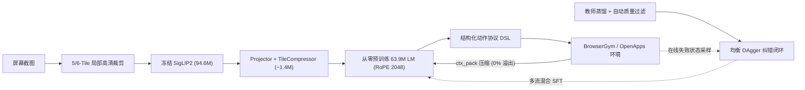

<div align="center">

# MiniMind-O Action

**63.9M 从零预训练语言主干 + 冻结 SigLIP2 轻量级多模态 GUI Agent**

[**English**](README.md) · [**简体中文**](README_CN.md)

<p>
  
  
  
  
  
</p>

<p>
  <a href="#真实演示">真实演示</a> •
  <a href="#核心技术亮点">核心亮点</a> •
  <a href="#模型架构">模型架构</a> •
  <a href="#核心实验结果">核心结果</a> •
  <a href="#快速开始">快速开始</a> •
  <a href="#文档导航">文档导航</a>
</p>

</div>

---

探索轻量级多模态 GUI Agent 的能力边界：从随机初始化预训练 **63.9M MiniMind Dense 语言主干**（`3.61B` tokens → RoPE `2048`），接入**冻结 SigLIP2（`94.6M`）**视觉编码器（系统总参数约 `160M`，可训练 `65.3M`），在 BrowserGym 与 OpenApps 中完成闭环控制。

> **姊妹仓库：** [**GUI Agent Post-Training**](https://github.com/ca1tshame/gui-agent-posttraining) *（原 `GUI-Transition-Verifier`）* —— 探索互补的大模型方向：`Qwen3-VL-8B` 策略 LoRA 后训练（Dev `10/19`、Heldout `7/12`）、过程验证与 `fastPE` 加速。

---

## 真实演示

以下 GIF 均由**纯学生模型在真实 Playwright / BrowserGym / OpenApps 环境中实时运行录制**（[`assets/demo/`](assets/demo/)），画面叠加层仅记录模型输出的动作字符串与环境奖励。

<table>
  <tr>
    <td align="center" width="50%">
      <br/>
      <sub><b>19 步跨三应用复合任务</b> — 日历 + 待办 + 消息自主联动（<code>48.8s</code>，通过）</sub>
    </td>
    <td align="center" width="50%">
      <br/>
      <sub><b>Frozen-20 一次性测试任务</b> — 未见正式句式消息发送（5 步通过）</sub>
    </td>
  </tr>
  <tr>
    <td align="center" width="50%">
      <br/>
      <sub><b>OOD 抗干扰鲁棒性</b> — 含无关上下文干扰的消息任务（5 步通过）</sub>
    </td>
    <td align="center" width="50%">
      <br/>
      <sub><b>MiniWoB++ 滚动 + 点击</b> — <code>scroll_at</code> 后精准点击（2 步通过）</sub>
    </td>
  </tr>
</table>

---

## 核心技术亮点

* **63.9M 语言主干从零预训练**：基于随机初始化完成 `3.61B` tokens 预训练与 RoPE `2048` 扩窗，2048 窗口验证集 NLL 由 `2.344` 降至 **`1.578`**。
* **6-Tile 局部高清视觉融合**：将外部冻结 `SigLIP2-base-p32-256`（`94.6M`）与全局 + `2×2` + 原生 `480×360` 中心聚焦裁剪结合，OpenApps 受控消融中表单点击聚焦率由 `85.7%` 升至 **`100.0%`**。
* **动态上下文压缩（`ctx_pack`）**：按 Token 预算自适应打包多轮历史与屏幕状态（`ctx=768, vt=384`），将长程交互溢出率由 `42.2%` 降至 **`0%`**。
* **教师蒸馏与均衡 DAgger 闭环**：结合教师轨迹过滤与 `--balance-dagger` 纠正 `16:1` 任务类别采样失衡，在固定布局 OpenApps Dev 取得 **`66.7%（8/12）`**，在 MiniWoB++ 独立测试集保持 **`71.88%（23/32）`**。

---

## 模型架构



---

## 核心实验结果

| 评测任务 / 指标 | 模型版本与评测口径 | 核心结果 |
| --- | --- | --- |
| **2048 窗口语言 SFT NLL** | `P1.5 → P1.6 Full SFT`（`n=53` 文档） | **`2.344 → 1.578`** |
| **长程上下文溢出率** | `V16–V18` `ctx_pack`（`ctx=768, vt=384`） | **`42.2% → 0%`** |
| **OpenApps 输入框聚焦率** | `V16` 配对消融（`vt=320` vs `384`） | **`85.7% → 100.0%`** |
| **OpenApps 固定布局 Dev（12 题）** | `V17` 均衡 DAgger（`1920×1080`） | **`8/12`（`66.7%`）** |
| **MiniWoB++ 独立 32 局测试** | `V17` 与 `V18`（`Screen: {W}x{H}`） | **`23/32`（`71.88%`）** |

> *注：`V17`（固定布局专精）与 `V18`（多分辨率探索）对应不同实验配置。`OOD-Dev` 非显著变化（`2/24 → 5/24`，`p=0.25`）、`Frozen-20`（`3/20`）与未见分辨率多步上限（`0/15`, `0/12`），以及 V12/V13 稀疏奖励 GRPO 零方差分析均完整保留于 [`docs/V18_GENERALIZATION_REPORT.md`](docs/V18_GENERALIZATION_REPORT.md)。*

---

## 快速开始

仓库内置全部 **125 项 CPU 单元测试**，无需 GPU、浏览器或模型权重即可本地验证：

```bash
git clone https://github.com/ca1tshame/minimind-o-action.git
cd minimind-o-action
python -m venv .venv && . .venv/bin/activate
pip install -r requirements.txt

python -m unittest discover -s tests -t .
```

> 单步推理演示、MiniWoB 240 局评测、GUI SFT 与 GRPO 训练依赖 `$MINIMIND_WORKSPACE` 下的本地权重及 Playwright/BrowserGym 环境，完整命令与实测资源开销（`A40 524 ms/步，343 MB 显存`）见 [`docs/V18_GENERALIZATION_REPORT.md`](docs/V18_GENERALIZATION_REPORT.md) 与 [`docs/GITHUB_RELEASE_REPORT.md`](docs/GITHUB_RELEASE_REPORT.md)。

---

## 文档导航

- [`docs/V18_GENERALIZATION_REPORT.md`](docs/V18_GENERALIZATION_REPORT.md)：V15–V18 聚焦裁剪、均衡 DAgger、`Screen: {W}x{H}` 实验、OOD/跨分辨率瓶颈及 A40/CPU 实测数据。
- [`docs/GITHUB_RELEASE_REPORT.md`](docs/GITHUB_RELEASE_REPORT.md)：P1.5/P1.6 预训练指标、MiniWoB 240 局演进、V9 定位头消融、V12/V13 GRPO 负实验与纯文本探针测试。
- [`assets/demo/README.md`](assets/demo/README.md)：所有闭环演示 GIF 的轨迹 SHA-256 校验元数据。

**开源协议：** 代码采用 Apache-2.0（[`LICENSE`](LICENSE)）；`SigLIP2` 与 `OpenApps`（CC BY-NC 4.0）遵循各自上游协议，模型权重与原始截图不随仓分发。
